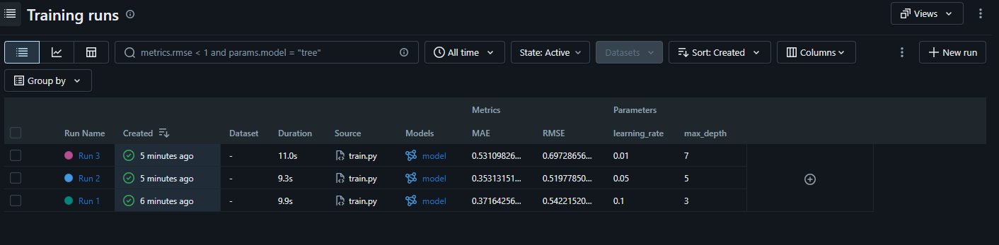

# MLflow Experiment Tracking: California Housing

## 1. Task description

Train the same regression model (`GradientBoostingRegressor`) three times with different hyperparameters on the California Housing dataset, track every run with MLflow (parameters, metrics, model artifact), compare the runs, and select the best model using **RMSE** as the primary metric.

- Data split: 80% training / 20% validation, fixed seed (`random_state=42`)
- Tracked parameters: `max_depth`, `learning_rate`
- Tracked metrics: `RMSE`, `MAE`, `R2`
- Each trained model is saved as an MLflow artifact

## 2. How to run

```bash
# 1. (optional) create a virtual environment
python -m venv venv
venv\Scripts\activate       

# 2. install dependencies
pip install -r requirements.txt

# 3. run the three experiments
python train.py

# 4. open the MLflow UI (run this in the same folder, then visit http://127.0.0.1:5000)
mlflow ui
```

The first run downloads the dataset, so an internet connection is needed.

## 3. MLflow experiment results 



## 4. Comparison table

<!-- Paste the table printed by train.py, or copy the values from the MLflow UI. -->

| Run | Max Depth | Learning Rate | RMSE | MAE | R2 |
|---|---|---|---|---|---|
| Run 1 | 3 | 0.1 | 0.5422 | 0.3716 | 0.7756 |
| Run 2 | 5 | 0.05 | 0.5198 | 0.3531 | 0.7938 |
| Run 3 | 7 | 0.01 | 0.6973 | 0.5311 | 0.6290 |

## 5. Selected best model

**Run 2** (max_depth = 5, learning_rate = 0.05) with a validation RMSE of 0.5198.
## 6. Why this model was selected

RMSE was the primary selection metric, and Run 2 has the lowest RMSE (0.5198), so its predictions are closest to the true house prices on the validation set. The target is in units of $100,000, so this is an average error of roughly $52,000. Run 2 is also best on the other two metrics: the lowest MAE (0.3531) and the highest R² (0.7938), so it explains about 79% of the variance in house prices. The three metrics agree, which makes the choice clear.

The other runs were worse for different reasons:

Run 1 (depth 3, learning rate 0.1) is close but slightly behind. Its shallower trees are likely less able to capture the interactions between features.
Run 3 (depth 7, learning rate 0.01) is clearly the worst. With a learning rate of 0.01 and the default 100 trees, the model learns too slowly and is probably undertrained, so the deeper trees did not help.

Run 2 balances tree depth and learning rate best for this setup. Note that I did not tune the number of trees; a smaller learning rate such as 0.01 would likely need many more trees to compete.